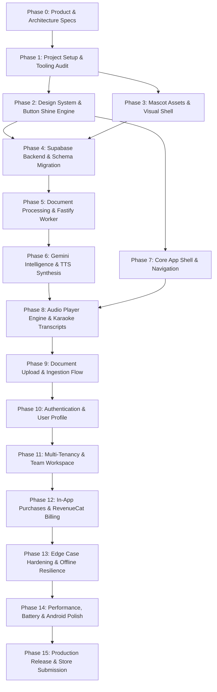

# Zukai — 15-Phase Master Engineering Roadmap
**Document Version:** 1.0.0  
**Architecture Status:** Planning Complete, Pending Architecture Approval

---

## Roadmap Overview & Dependency Graph

---

## Detailed Phase Breakdown (Phases 1 to 15)

### Phase 1: Project Foundation & Tooling Setup
- **Goal:** Establish a pristine Expo SDK 58 TypeScript development environment configured for Android-first architecture.
- **Deliverables:**
  - Audit existing `zukai/` project dependencies, package locks, and TypeScript configs.
  - Setup ESLint, Prettier, and path aliases (`@components`, `@hooks`, `@services`, `@constants`).
  - Configure Android permissions in `app.json` (Audio playback, Foreground service, Storage/Media read).
  - Verify zero-error local build on Android emulator/device.
- **Dependencies:** Approved Phase 0 Architecture Docs.

### Phase 2: Design System Tokens & "Shine Button" Engine
- **Goal:** Implement the brand design tokens, glassmorphic card primitives, and the signature gloss/shine button component.
- **Deliverables:**
  - Token files in `src/constants/theme.ts`: Exact sampled colors (`#92F702`, `#09161B`, etc.), typography scale, spacing.
  - `GlossButton` component: 6-layer architecture (outer glow, 1px light border, top gloss gradient, idle shimmer sweep, medium haptic press).
  - `GlassCard` component: Dynamic frosted background blur, inner border, subtle glow.
  - Interactive Component Catalog / Storybook screen for testing all button states and glass cards.
- **Dependencies:** Phase 1.

### Phase 3: Mascot Integration & Visual Assets
- **Goal:** Import and integrate the Zuke mascot family across all states and poses.
- **Deliverables:**
  - Vector SVG and high-resolution PNG assets for all 8 poses (`welcome`, `uploading`, `thinking`, `listening`, `success`, `error`, `empty`, `paywall`).
  - Lottie animation integrations for `thinking` (processing loop) and `listening` (subtle pulse).
  - Mascot wrapper component with responsive sizing and emotional state switches.
- **Dependencies:** Phase 2.

### Phase 4: Supabase Backend Infrastructure & Database Migrations
- **Goal:** Instantiate the Supabase backend with fully normalized tables, indexes, and Row-Level Security (RLS) policies.
- **Deliverables:**
  - SQL migrations for all 12 core tables: `profiles`, `organizations`, `memberships`, `documents`, `audio_jobs`, `audio_tracks`, `chapters`, `transcripts`, `playback_progress`, `subscriptions`, `usage_events`, `audit_logs`.
  - Postgres RLS security policies enforcing tenant isolation via `org_id`.
  - Supabase Storage buckets configured: `raw-documents` (private, encrypted) and `audio-tracks` (authenticated CDN access).
  - Supabase Database triggers for profile creation and audit logging.
- **Dependencies:** Phase 1, Phase 2.

### Phase 5: Fastify Worker & Document Ingestion Engine
- **Goal:** Build the high-performance Node.js / Fastify backend worker responsible for parsing, extracting, and normalizing documents.
- **Deliverables:**
  - Fastify microservice running with TypeScript and BullMQ / Redis job queue.
  - Multi-format document parser: PDF (`pdf-parse`), Word (`mammoth`), PowerPoint (`officeparser`), and Plaintext.
  - Semantic chunker and outline extractor (extracts H1, H2, sections, word counts).
  - Error-handling middleware for encrypted, empty, and corrupted files.
- **Dependencies:** Phase 4.

### Phase 6: Gemini Intelligence Layer & Spoken Audio Synthesis
- **Goal:** Connect Gemini 1.5 Flash for script drafting and Gemini TTS for lifelike voice synthesis.
- **Deliverables:**
  - Gemini prompt pipeline implementing the *Explanation Style Guide* (analogies, short sentences, hooks, and recaps).
  - English and Romanized Hinglish script generators with phonetic dictionary normalization.
  - Gemini TTS streaming client with chunked audio generation.
  - Audio assembly module using FFmpeg to stitch chunks, normalize loudness to -16 LUFS, and output AAC/M4A with chapter tags.
- **Dependencies:** Phase 5.

### Phase 7: Mobile Navigation Architecture & Core App Shell
- **Goal:** Build the complete screen layout and navigation shell using Expo Router.
- **Deliverables:**
  - File-based routing structure: `_layout.tsx`, tabs (`home`, `library`, `team`, `settings`), and modal stacks (`player`, `upload`, `paywall`).
  - Custom glassy bottom tab bar with subtle neon highlights on active tabs.
  - Screen scaffoldings with ambient gradient mesh backgrounds as defined in `DESIGN_PRINCIPLES.md`.
- **Dependencies:** Phase 2, Phase 3.

### Phase 8: Enterprise Audio Player Engine & Synchronized Transcripts
- **Goal:** Implement an Apple-grade, high-performance audio player with background playback and interactive karaoke transcripts.
- **Deliverables:**
  - Audio engine using `expo-av` or `react-native-track-player` with Android foreground media service and lockscreen controls.
  - Full-screen player UI: gradient backdrop, waveform visualizer, variable playback speed (0.75x to 2.5x), 15s skip buttons.
  - Real-time karaoke transcript view: auto-scrolls to the active spoken sentence with one-tap seeking to any phrase.
  - Playback progress throttled persistence to Supabase `playback_progress`.
- **Dependencies:** Phase 7, Phase 6.

### Phase 9: Document Upload & Real-Time Processing UI
- **Goal:** Implement the user-facing upload sheets, configuration modals, and live processing visualizer.
- **Deliverables:**
  - Native document picker sheet supporting PDF, DOCX, PPTX, and TXT.
  - Audio Configuration modal: Depth mode selector (Quick/Standard/Deep Dive) and Language selector (English/Hinglish).
  - Real-time processing screen powered by Supabase Realtime websocket subscriptions, animated with `Zuke-Thinking` Lottie.
  - In-app notification and haptic trigger upon audio completion.
- **Dependencies:** Phase 8, Phase 5.

### Phase 10: Authentication, Onboarding & User Profiles
- **Goal:** Build seamless user onboarding, authentication, and profile preference management.
- **Deliverables:**
  - 3-slide onboarding tour with mascot animations and feature highlights.
  - One-tap Google Sign-In and Email OTP authentication via Supabase Auth.
  - Automatic organization and profile provisioning upon signup.
  - Profile settings screen: manage display name, avatar, and default audio language preference.
- **Dependencies:** Phase 7, Phase 4.

### Phase 11: Multi-Tenancy & Team Workspace Collaboration
- **Goal:** Activate multi-tenant enterprise collaboration features for teams and organizations.
- **Deliverables:**
  - Workspace switcher: toggle between "Personal Workspace" and enterprise organizations.
  - Team dashboard tab: shared document library, team audio playlists, and member activity feed.
  - Member management UI: invite teammates via email/link, manage roles (Admin vs. Member), and revoke access.
  - Audit log viewer for Organization Admins.
- **Dependencies:** Phase 10, Phase 4.

### Phase 12: In-App Purchases, Billing & RevenueCat Paywall
- **Goal:** Implement monetization with RevenueCat and Google Play In-App Billing.
- **Deliverables:**
  - RevenueCat SDK configuration for Android.
  - Glassmorphic Paywall modal with annual vs. monthly billing selector, savings badges, and feature comparison table.
  - Entitlement enforcement: gate Deep Dive audio, 100+ page docs, and monthly minutes behind Pro tier.
  - Server-side webhook handling in Supabase to sync subscription states in real-time.
- **Dependencies:** Phase 10, Phase 4.

### Phase 13: Edge Case Hardening & Offline Resilience
- **Goal:** Guarantee fault tolerance for intermittent network conditions, corrupted files, and system interruptions.
- **Deliverables:**
  - Comprehensive client-side offline cache for downloaded audio tracks and transcripts.
  - Graceful reconnection handling for Supabase Realtime sockets.
  - Error boundaries with `Zuke-Error` illustration and automated error reporting.
  - Retry logic for transient Gemini API rate limits (HTTP 429) with exponential backoff.
- **Dependencies:** Phase 9, Phase 8.

### Phase 14: Performance, Battery Optimization & Android Device Polish
- **Goal:** Ensure smooth 60fps animations, minimal battery drain during playback, and hardware compliance across diverse Android devices.
- **Deliverables:**
  - Memory leak audit using Android Studio Profiler (ensuring background audio uses < 2% battery/hour).
  - Frame rate profiling to guarantee zero jank during transcript scrolling and mesh gradient rendering.
  - Testing across screen sizes: small budget phones (6.0"), standard flagships (6.7"), and Android tablets/foldables.
  - Dark mode OLED black tuning to eliminate color banding and pixel smear.
- **Dependencies:** Phase 8, Phase 13.

### Phase 15: Production Hardening, Compliance & Google Play Store Launch
- **Goal:** Package, sign, and submit Zukai to the Google Play Store for enterprise and consumer production release.
- **Deliverables:**
  - Production EAS build profiles configured (`production`, `release-apk`, `aab`).
  - Google Play Store asset bundle: App icons, featured graphic banner, and high-res store screenshots featuring Zuke mascot.
  - Privacy Policy and Terms of Service documents (covering AI synthesis, zero data retention, and audio rights).
  - Google Play Console submission, internal test track distribution, and production rollout.
- **Dependencies:** All preceding phases (Phase 1–14).

