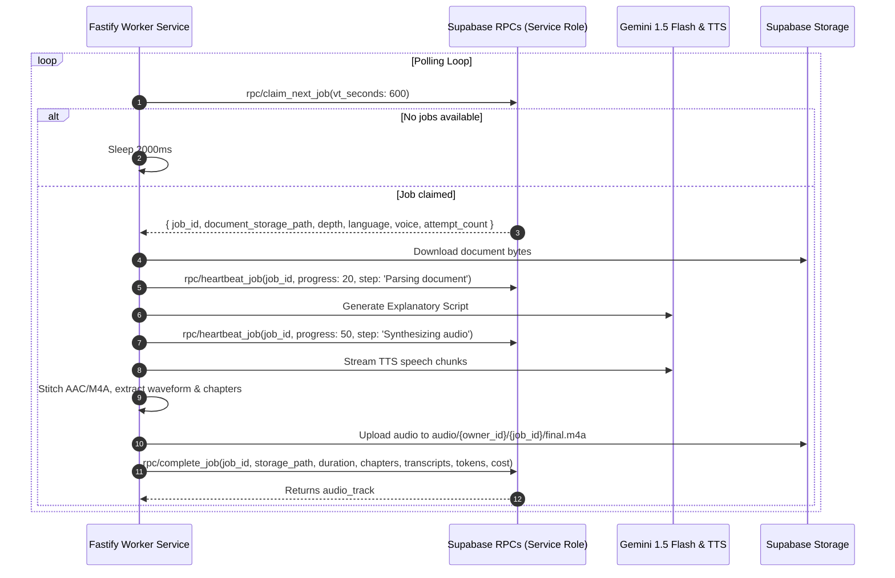

# Zukai — Asynchronous Queue Contract & Worker Protocol
**Document Version:** 1.0.0  
**Target:** Fastify AI Audio Worker (Phase 6)  
**Queue Technology:** Postgres Message Queue (`pgmq`) & Supabase Service RPCs

---

## 1. Overview
Document conversion to synthesized speech is an asynchronous, multi-stage pipeline taking between 15 and 90 seconds. To isolate long-running CPU/GPU-intensive tasks from the HTTP API, work is queued in Postgres and consumed by stateless worker instances.

---

## 2. Worker Lifecycle & Protocol



---

## 3. Worker RPC Specifications

### 1. `claim_next_job(p_vt_seconds int default 600)`
- **Caller:** Service Role only.
- **Behavior:** Finds oldest job in `queued` status using `FOR UPDATE SKIP LOCKED`. Atomically transitions status to `extracting`, increments `attempt_count`, and returns document metadata.
- **Returns:**
  ```json
  {
    "job_id": "uuid",
    "document_id": "uuid",
    "owner_id": "uuid",
    "org_id": "uuid | null",
    "language": "english | hinglish",
    "depth": "quick | standard | deep",
    "voice": "alloy",
    "attempt_count": 1,
    "document_storage_path": "uploads/user_123/doc_456/original.pdf",
    "mime_type": "application/pdf",
    "file_size_bytes": 1048576
  }
  ```

### 2. `heartbeat_job(p_job_id uuid, p_progress smallint, p_current_step text)`
- **Caller:** Service Role only.
- **Interval:** Must be called at least once every 60 seconds while processing.
- **Behavior:** Updates `progress` (0–100) and `current_step` in `public.audio_jobs`, emitting Realtime websocket updates to the mobile client.

### 3. `fail_job(p_job_id uuid, p_error_code text, p_error_message text)`
- **Caller:** Service Role only.
- **Behavior:**
  - If `attempt_count < 3`: Resets status to `queued` with retry message for exponential backoff.
  - If `attempt_count >= 3`: Sets status to `failed`, records `error_code`, `error_message`, and writes an immutable audit log.

### 4. `complete_job(...)`
- **Caller:** Service Role only.
- **Parameters:** `p_job_id`, `p_storage_path`, `p_duration_seconds`, `p_format`, `p_bitrate_kbps`, `p_file_size_bytes`, `p_chapters`, `p_transcripts`, `p_input_tokens`, `p_output_tokens`, `p_tts_characters`, `p_cost_micros`.
- **Behavior:**
  - Atomically creates `audio_tracks`, `chapters`, and `transcripts`.
  - Marks `audio_jobs` as `ready` (`progress = 100`).
  - Marks `documents` as `ready`.
  - Inserts metered `usage_events` (`audio_minutes`).
  - Writes audit log.

