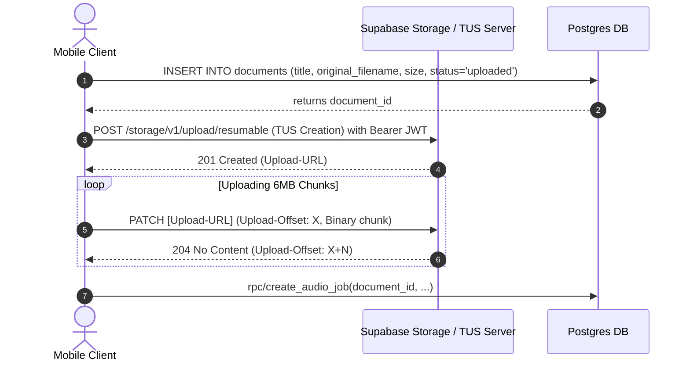

# Zukai — Storage Architecture & Media Delivery Design
**Document Version:** 1.0.0  
**Scope:** Resumable File Uploads (TUS), Encrypted Audio Streaming, and Object Access Controls

---

## 1. Storage Buckets & Hierarchy

All buckets are configured with `public = false`. No asset is accessible via raw public URLs.

| Bucket | Max File Size | Allowed MIME Types | Access Model |
| :--- | :--- | :--- | :--- |
| `uploads` | 250 MB | `.pdf`, `.docx`, `.pptx`, `.txt` | Owner write/read; Org member read via RLS |
| `audio` | 100 MB | `.m4a`, `.mp3`, `.aac` | Service-role write only; Owner/Org stream read |
| `avatars` | 5 MB | `.png`, `.jpg`, `.jpeg`, `.webp` | User folder isolated (`{user_id}/*`) |

### Path Conventions:
- **`uploads`**: `uploads/{owner_id}/{document_id}/original.{ext}`
- **`audio`**: `audio/{owner_id}/{job_id}/final.m4a`
- **`avatars`**: `avatars/{user_id}/avatar.{ext}`

---

## 2. Ingestion Pipeline: TUS Resumable Uploads

### Why TUS Resumable Uploads?
1. **Network Volatility on Mobile:** Mobile networks in emerging markets experience frequent signal transitions (4G to 3G or cellular dropouts). Standard HTTP multipart uploads fail completely on connection drops, requiring full re-transmission.
2. **250 MB Payload Handling:** Large documents (e.g., 300-page scanned legal briefs or 100MB pitch decks) take several minutes on slow uplinks. TUS chunks payloads into 6MB slices, resuming from the exact byte offset upon reconnect.
3. **Low Client Memory Footprint:** Upload streams chunks directly from local storage via `expo-file-system` without buffering the entire 100MB file into mobile JavaScript memory.

### Upload Flow:

---

## 3. Audio Playback Delivery: Short-Lived Signed URLs

### Why Short-Lived Signed URLs?
1. **Zero Public Content Exposure:** Audio syntheses are proprietary user assets containing sensitive business documents, financial disclosures, and personal notes.
2. **Preventing Hotlinking & Scraping:** Direct persistent URLs can be extracted and shared outside the app, bypassing subscription billing and data governance.
3. **TTL Strategy:**
   - Playback URLs are generated on-demand via `supabase.storage.from('audio').createSignedUrl(path, 3600)` with a 60-minute time-to-live.
   - The native audio engine (`react-native-track-player`) caches downloaded chunks locally in a secure, sandboxed cache directory.
   - For offline downloads on Pro/Team tiers, encrypted audio buffers are verified with the active subscription before saving to the app's isolated document folder.

