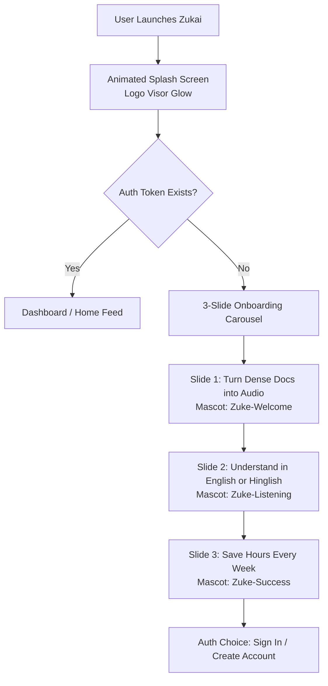
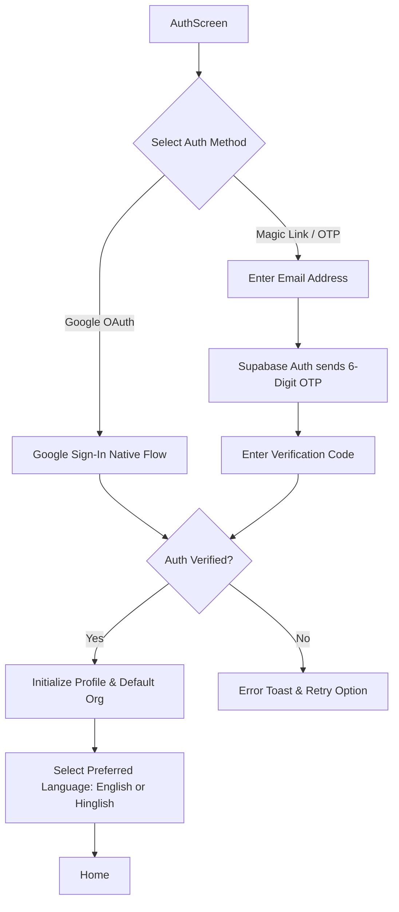
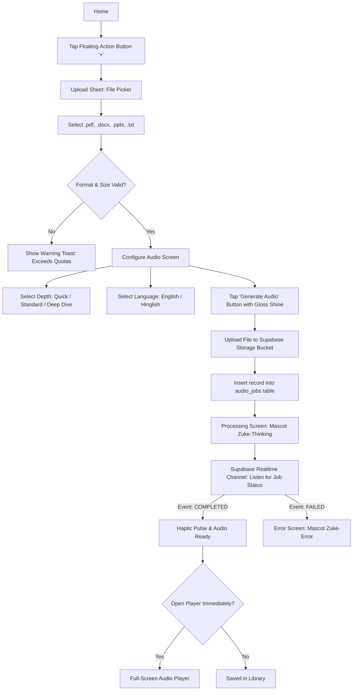
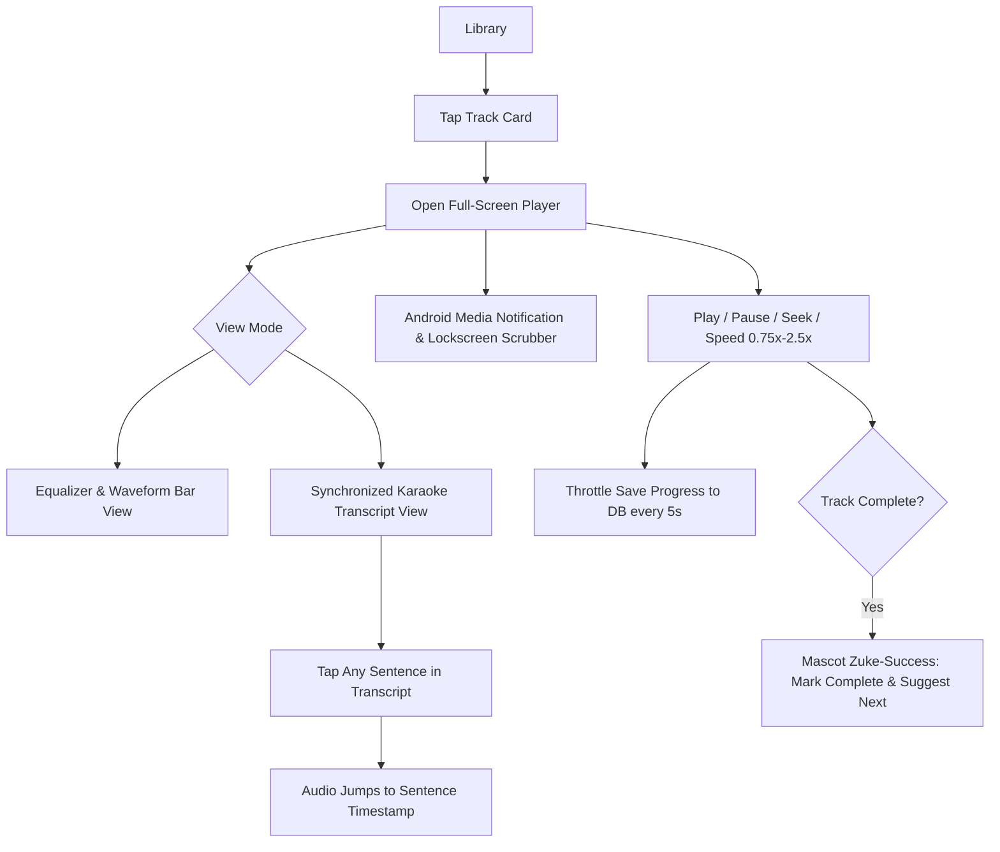
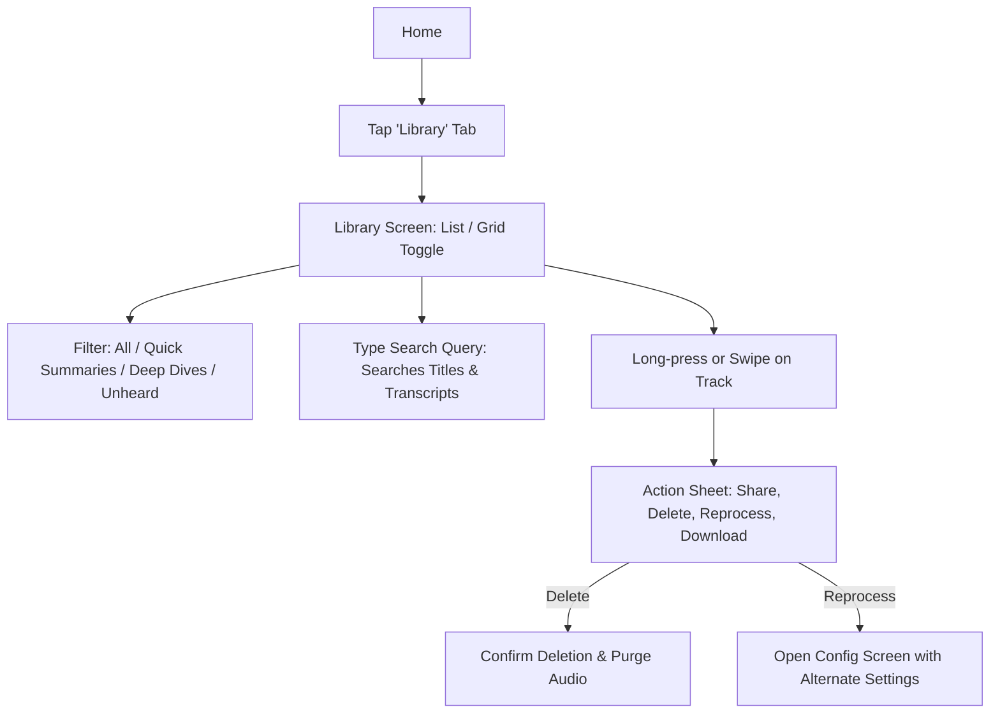
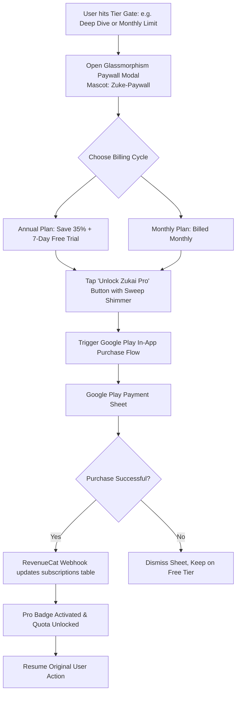
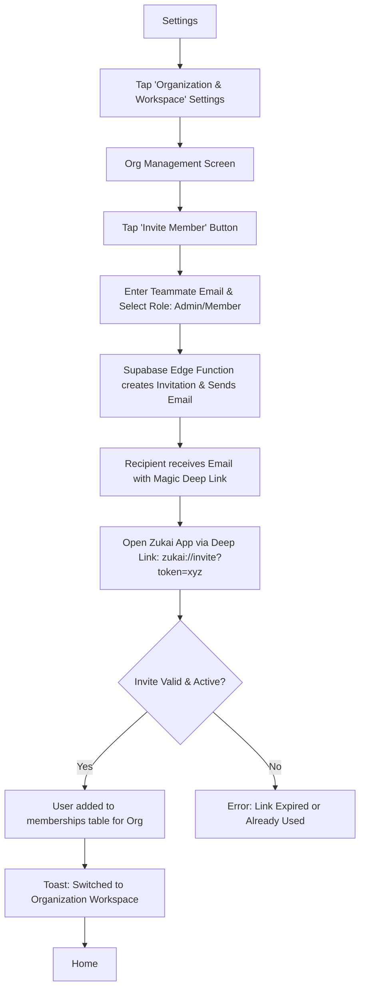

# Zukai — User Flows and Screen Inventory
**Document Version:** 1.0.0  
**Scope:** End-to-End User Experience, Navigation Architecture, and Screen Specifications

---

## 1. Core User Flows (Mermaid Diagrams)

### Flow 1: First Launch & Interactive Onboarding

---

### Flow 2: Sign Up & Authentication

---

### Flow 3: Upload to Audio Processing Pipeline

---

### Flow 4: Listening Experience & Real-time Transcript

---

### Flow 5: Library Management & Search

---

### Flow 6: Subscription & Paywall Upgrade

---

### Flow 7: Team Organization & Member Invitation

---

## 2. Complete Screen Inventory

| Screen Route | Screen Name | Purpose & Functional Highlights | Mascot State |
| :--- | :--- | :--- | :--- |
| `/splash` | **Splash Screen** | Animated cold boot screen. Neon visor glow animation. Checks session auth and directs to `/onboarding` or `/(tabs)/home`. | Logo Visor Pulse |
| `/onboarding` | **Onboarding Carousel** | 3-slide value-prop tour explaining document listening, English/Hinglish synthesis, and time savings. | `Zuke-Welcome`, `Zuke-Listening`, `Zuke-Success` |
| `/(auth)/sign-in` | **Authentication Screen** | One-tap Google Sign-In and Email OTP login. Glassmorphic card over dark radial gradient. | `Zuke-Welcome` |
| `/(tabs)/home` | **Dashboard / Home** | Daily summary, quick stats (minutes listened, time saved), currently processing banner, "Continue Listening" hero card, and recent documents. | `Zuke-Listening` (Mini Badge) |
| `/(tabs)/library` | **Library & Archives** | Searchable repository of all processed documents, audio tracks, and playlists. Filterable by language, depth, and read status. | `Zuke-Empty` (when 0 tracks) |
| `/(tabs)/team` | **Team Workspace** | Enterprise organization feed. Shows team-shared documents, leaderboards, departmental playlists, and member activity. | `Zuke-Welcome` |
| `/(tabs)/settings` | **Settings & Preferences**| Account management, default audio language selector, preferred playback speed, storage cache clearing, and help center. | None (Clean Settings) |
| `/upload/picker` | **Document Upload Sheet** | Native Android system file picker supporting PDF, DOCX, PPTX, TXT. File inspection and validation preview. | `Zuke-Uploading` |
| `/upload/configure`| **Audio Configuration** | Selection screen for Depth Mode (Quick / Standard / Deep Dive), Spoken Voice, and Output Language (English / Hinglish). | `Zuke-Thinking` |
| `/upload/processing`| **Processing & Assembly** | Real-time animated progress screen tracking: Extracting $\rightarrow$ Synthesizing $\rightarrow$ Vocalizing. Displays witty micro-tips while waiting. | `Zuke-Thinking` (Animated) |
| `/player/full` | **Full Audio Player** | Immersive Apple-style player. Gradient mesh background, interactive scrub bar, speed pills, chapter markers, and synced karaoke transcript. | `Zuke-Listening` |
| `/paywall` | **Zukai Pro Paywall** | High-conversion subscription screen. Feature matrix comparison, Google Play Billing integration, testimonials, and FAQ. | `Zuke-Paywall` |
| `/org/members` | **Team Members & RBAC** | Admin view for listing team members, pending invites, role changes (Member $\leftrightarrow$ Admin), and removal. | None (Data Table) |
| `/error` | **Global Error Screen** | Friendly fallback for network disconnects, server timeouts, or quota rejections. Includes one-tap retry button. | `Zuke-Error` |

