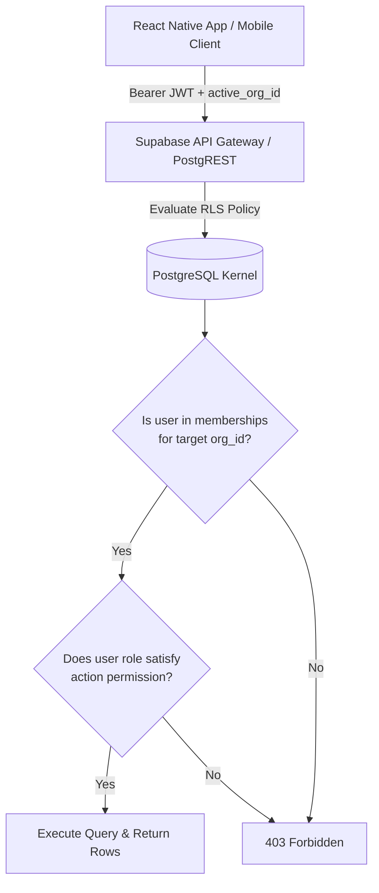

# Zukai — User Roles, Permissions & Multi-Tenancy Architecture
**Document Version:** 1.0.0  
**Scope:** Identity, Access Control (RBAC), Row-Level Security (RLS), and Organization Isolation

---

## 1. Architectural Principles of Multi-Tenancy

Zukai is built from day one as an enterprise-grade multi-tenant platform. Every user begins with a default **Personal Workspace** (which operates behind the scenes as a personal single-user organization) and can create or be invited into multi-user **Team / Enterprise Organizations**.

### Tenancy Invariants:
1. **The `org_id` First Rule:** Every tenant-partitioned table (`documents`, `audio_jobs`, `audio_tracks`, `chapters`, `transcripts`, `playback_progress`, `subscriptions`, `usage_events`, `audit_logs`) MUST possess a mandatory, foreign-keyed `org_id` column.
2. **Postgres Row-Level Security (RLS) as Ground Truth:** Access control is enforced at the database kernel level via Supabase Postgres RLS policies—never solely trusted to client-side code or middle-tier controllers.
3. **Audit Trail Completeness:** All write, update, delete, role alteration, and download operations generate an immutable record in `audit_logs` bearing `org_id`, `actor_id`, `resource_type`, `action`, and `ip_address`.

---

## 2. Role Definitions

1. **Platform Admin (Super-Admin):**
   - Internal Zukai operations, security engineers, and support leads.
   - Access to global health, AI quota allocation, billing overrides, and abuse mitigation. Cannot access tenant document contents unless explicit permission is granted for support debugging.
2. **Organization Owner:**
   - The creator or designated primary executive of an enterprise workspace.
   - Full legal authority over the organization: billing, subscription tier, ownership transfer, domain whitelisting, deletion of the organization, and audit log export.
3. **Organization Admin:**
   - Team leads, department managers, and IT administrators.
   - Manages members (invite, promote to admin, remove), manages shared folders, sets retention policies, and monitors quota consumption. Cannot delete the organization or transfer ownership.
4. **Organization Member:**
   - Standard employees and knowledge workers.
   - Uploads documents, generates audio, listens to shared team playlists, creates personal bookmarks, and views team-shared transcripts. Cannot manage users, billing, or audit logs.
5. **Individual User (Free / Pro Single-Seat):**
   - Solo consumer or student operating within their private personal workspace (`org.is_personal = true`).
   - Acts as Owner of their personal workspace with no multi-user administrative features.

---

## 3. Permissions Matrix

| Action / Capability | Platform Admin | Org Owner | Org Admin | Org Member | Individual User |
| :--- | :---: | :---: | :---: | :---: | :---: |
| **Workspace & Billing** | | | | | |
| Delete Organization | ❌ (Support only) | ✅ | ❌ | ❌ | ✅ (Personal) |
| Upgrade / Downgrade Subscription | ✅ | ✅ | ❌ | ❌ | ✅ |
| Manage Payment Methods (Google Play/Stripe) | ❌ | ✅ | ❌ | ❌ | ✅ |
| View Organization Invoice & Quota Spend | ✅ | ✅ | ✅ | ❌ | ✅ |
| Configure Org Security & Retention Rules | ✅ | ✅ | ✅ | ❌ | ❌ |
| **User & Team Management** | | | | | |
| Invite New Members | ❌ | ✅ | ✅ | ❌ | ❌ |
| Remove Members | ❌ | ✅ | ✅ | ❌ | ❌ |
| Promote Member to Admin | ❌ | ✅ | ❌ | ❌ | ❌ |
| Transfer Org Ownership | ❌ | ✅ | ❌ | ❌ | ❌ |
| **Document Ingestion & AI Generation**| | | | | |
| Upload Document (Within Quota) | ✅ | ✅ | ✅ | ✅ | ✅ |
| Delete Own Uploaded Document | ✅ | ✅ | ✅ | ✅ | ✅ |
| Delete Any Member's Document | ✅ | ✅ | ✅ | ❌ | N/A |
| Trigger Audio Generation (Quick/Std/Deep) | ✅ | ✅ | ✅ | ✅ | ✅ (Tier gated) |
| Reprocess Audio with Alternate Voice/Lang | ✅ | ✅ | ✅ | ✅ | ✅ |
| **Playback & Library** | | | | | |
| Listen to Own Generated Audio | ✅ | ✅ | ✅ | ✅ | ✅ |
| Listen to Team Shared Document Audio | ✅ | ✅ | ✅ | ✅ | ❌ |
| Mark Document as "Org Public" | ❌ | ✅ | ✅ | ❌ | ❌ |
| Export Generated Audio (MP3/AAC Download)| ✅ | ✅ | ✅ | ✅ (If allowed)| ✅ |
| Synchronize Playback Progress across devices| ✅ | ✅ | ✅ | ✅ | ✅ |
| **Compliance, Security & Audit Logs** | | | | | |
| View Security Audit Logs | ✅ | ✅ | ✅ | ❌ | ❌ |
| Export Audit Logs (CSV / JSON) | ✅ | ✅ | ❌ | ❌ | ❌ |
| Trigger Emergency Tenant Data Erasure (GDPR)| ✅ | ✅ | ❌ | ❌ | ✅ |

---

## 4. Multi-Tenancy Data Isolation Pattern (RLS Architecture)

Every query executed from the mobile client or Fastify worker contains the authenticated session JWT. The database context resolves the active user ID and validates active membership in the target `org_id`.



### Core Supabase RLS Implementation Strategy (Postgres Helper Functions):
1. **`current_user_id()`**: Extracts `auth.uid()` from the Supabase session token.
2. **`user_has_org_role(target_org_id uuid, required_roles text[])`**: Evaluates whether the calling user holds an active membership row in `memberships` where `org_id = target_org_id` and `role = ANY(required_roles)`.
3. **Strict Partitioning Policy Template:**
   ```sql
   -- Conceptual policy model (actual migrations in Phase 4)
   CREATE POLICY org_isolation_policy ON documents
   FOR ALL
   USING (
     user_has_org_role(documents.org_id, ARRAY['owner', 'admin', 'member'])
   );
   ```
4. **Data Isolation Invariant:** No document, audio segment, or transcript row can ever be queried without specifying or evaluating `org_id`, mathematically preventing cross-tenant leakage.

