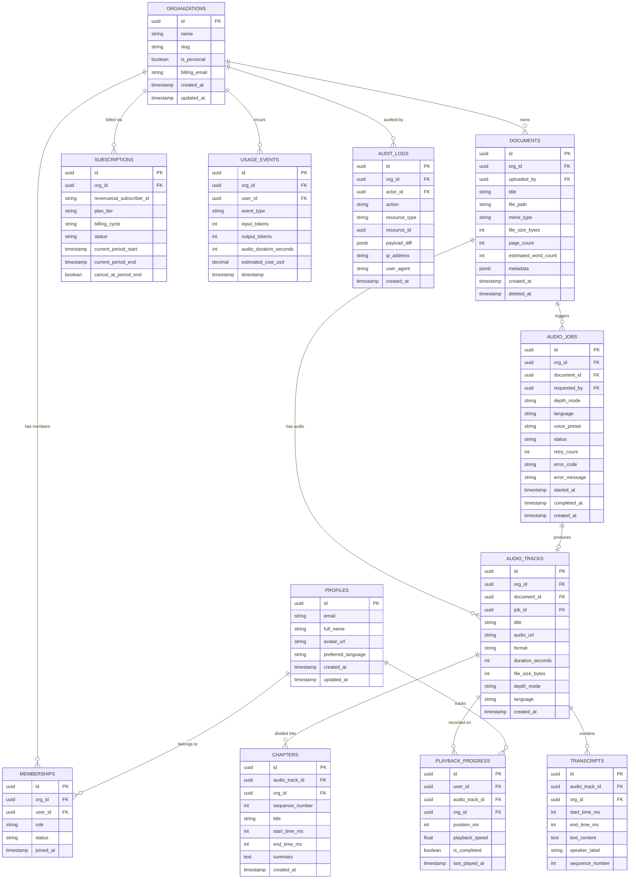
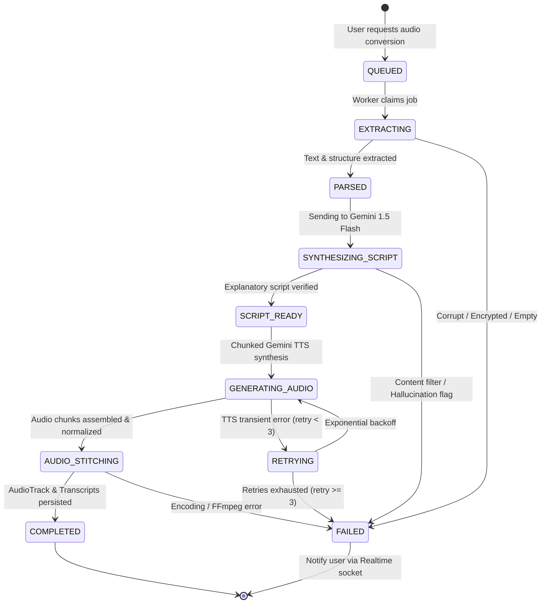

# Zukai — Data Model Draft & State Machine
**Document Version:** 1.0.0  
**Scope:** Conceptual & Logical Entity-Relationship Design, Job State Lifecycle  
*(Note: Concrete SQL migrations and DDL will be executed in Phase 4)*

---

## 1. Entity-Relationship (ER) Overview

The Zukai database schema is designed around two pillars: **strict multi-tenancy** (partitioned by `org_id`) and **asynchronous media pipeline tracking** (`audio_jobs`, `audio_tracks`, `chapters`, `transcripts`).

---

## 2. Detailed Entity Catalog

### 1. `profiles`
- **Purpose:** Extends Supabase `auth.users` with user preferences and identity.
- **Key Columns:** `id` (UUID, PK referencing `auth.users.id`), `email`, `full_name`, `avatar_url`, `preferred_language` (`en` or `hinglish`), `created_at`, `updated_at`.

### 2. `organizations`
- **Purpose:** Represents the tenant boundary. Every user belongs to at least one organization (personal or team).
- **Key Columns:** `id` (UUID, PK), `name`, `slug` (unique), `is_personal` (boolean indicating if it's the auto-created 1-user org), `billing_email`, `created_at`.

### 3. `memberships`
- **Purpose:** Junction table linking users to organizations with role-based access.
- **Key Columns:** `id` (UUID, PK), `org_id` (FK), `user_id` (FK), `role` (`owner`, `admin`, `member`), `status` (`active`, `invited`, `suspended`), `joined_at`.
- **Constraint:** Unique composite `(org_id, user_id)`.

### 4. `documents`
- **Purpose:** Metadata and storage reference for raw files uploaded by users.
- **Key Columns:** `id` (UUID, PK), `org_id` (FK), `uploaded_by` (FK `profiles`), `title`, `file_path` (Supabase Storage path), `mime_type`, `file_size_bytes`, `page_count`, `estimated_word_count`, `metadata` (JSONB for author, document dates, detected language), `created_at`, `deleted_at` (soft deletion).

### 5. `audio_jobs`
- **Purpose:** Asynchronous state tracking for document-to-speech orchestration.
- **Key Columns:** `id` (UUID, PK), `org_id` (FK), `document_id` (FK), `requested_by` (FK), `depth_mode` (`quick`, `standard`, `deep_dive`), `language` (`en`, `hinglish`), `voice_preset` (e.g., `gemini-alloy`, `gemini-fenrir`), `status`, `retry_count`, `error_code`, `error_message`, `started_at`, `completed_at`, `created_at`.

### 6. `audio_tracks`
- **Purpose:** The final synthesized audio assets ready for streaming playback.
- **Key Columns:** `id` (UUID, PK), `org_id` (FK), `document_id` (FK), `job_id` (FK), `title`, `audio_url` (Signed CDN/Storage URL), `format` (`aac`, `mp3`), `duration_seconds`, `file_size_bytes`, `depth_mode`, `language`, `created_at`.

### 7. `chapters`
- **Purpose:** Logical timestamps and navigational segments within an audio track.
- **Key Columns:** `id` (UUID, PK), `audio_track_id` (FK), `org_id` (FK), `sequence_number`, `title`, `start_time_ms`, `end_time_ms`, `summary`, `created_at`.

### 8. `transcripts`
- **Purpose:** Word or sentence-level synchronized transcripts for real-time player karaoke-scrolling.
- **Key Columns:** `id` (UUID, PK), `audio_track_id` (FK), `org_id` (FK), `sequence_number`, `start_time_ms`, `end_time_ms`, `text_content`, `speaker_label`.

### 9. `playback_progress`
- **Purpose:** Cross-device playback position tracking, speed preference, and completion state.
- **Key Columns:** `id` (UUID, PK), `user_id` (FK), `audio_track_id` (FK), `org_id` (FK), `position_ms`, `playback_speed` (e.g. 1.0, 1.25, 1.5), `is_completed`, `last_played_at`.
- **Constraint:** Unique composite `(user_id, audio_track_id)`.

### 10. `subscriptions`
- **Purpose:** Tier state and synchronization with RevenueCat / Google Play.
- **Key Columns:** `id` (UUID, PK), `org_id` (FK), `revenuecat_subscriber_id`, `plan_tier` (`free`, `pro`, `team`, `enterprise`), `billing_cycle` (`monthly`, `annual`), `status` (`active`, `grace_period`, `canceled`, `expired`), `current_period_start`, `current_period_end`, `cancel_at_period_end`.

### 11. `usage_events`
- **Purpose:** Fine-grained metering for LLM token usage, TTS seconds, and cost accounting.
- **Key Columns:** `id` (UUID, PK), `org_id` (FK), `user_id` (FK), `event_type` (`gemini_script_generation`, `gemini_tts_synthesis`), `input_tokens`, `output_tokens`, `audio_duration_seconds`, `estimated_cost_usd`, `timestamp`.

### 12. `audit_logs`
- **Purpose:** Immutable compliance logs for SOC2 / ISO27001 readiness.
- **Key Columns:** `id` (UUID, PK), `org_id` (FK), `actor_id` (FK), `action` (e.g. `document.upload`, `document.delete`, `org.member_invited`), `resource_type`, `resource_id`, `payload_diff` (JSONB), `ip_address`, `user_agent`, `created_at`.

---

## 3. Audio Job Status State Machine

### State Definitions:
- **`QUEUED`:** Document uploaded and job registered in DB. Awaiting Fastify worker dispatch.
- **`EXTRACTING`:** PDF/Office parser unpacking structural sections, discarding non-content artifacts.
- **`PARSED`:** Raw text cleaned, tokens counted, structured into outline blocks.
- **`SYNTHESIZING_SCRIPT`:** Gemini 1.5 Flash rewrites document into the target voice mode (English or Hinglish) using the Explanation Style Guide prompts.
- **`SCRIPT_READY`:** Script generated, validated against anti-hallucination heuristics, and segmented for TTS.
- **`GENERATING_AUDIO`:** Gemini TTS streams audio buffers per segment.
- **`AUDIO_STITCHING`:** Audio chunks assembled into AAC/M4A, loudness normalized (-16 LUFS), waveform peaks extracted, and timestamps aligned with transcripts.
- **`COMPLETED`:** Storage URL saved in `audio_tracks`, chapters and transcripts populated, Realtime event emitted to client.
- **`RETRYING`:** Transient API glitch; worker schedules retry with jittered exponential backoff (up to 3 attempts).
- **`FAILED`:** Terminal error state. Specific error code written to record, quota refunded if applicable, user notified with actionable UI message.
